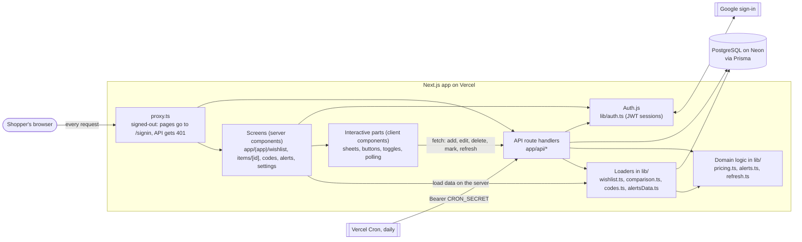

# LootLens architecture

LootLens is one Next.js app. The same app serves the screens people use and the JSON API behind them. It runs on Vercel and stores data in PostgreSQL on Neon. Sign-in is Google through Auth.js. Until a real price source is connected, prices, stock, and promo codes come from labelled demo data.

This page explains how the parts fit together. The database tables are in [schema.md](schema.md), and the API is described in `public/openapi.json` (served at `/api-docs`).

## The big picture

## How a screen is built

1. **The request.** `proxy.ts` checks for a session cookie. Signed-out page visits go to `/signin?callbackUrl=...`; signed-out API calls get a JSON 401.
2. **The page loads its data on the server.** For example, the Wishlist page calls `loadWishlist(userId)`. The user id always comes from the session (`requirePageUserId()` in `lib/currentUser.ts`), never from the URL or the request body.
3. **The same loader serves the API.** `GET /api/items` calls the same `loadWishlist`. Pages and the API therefore always show the same data in the same shape (the types in `lib/types.ts`).
4. **Prices and rules come from `lib/`.** The cheapest listing, the best total after codes and cashback, code freshness, trust flags, and alert rules are plain functions in `lib/pricing.ts` and `lib/alerts.ts`. Screens only display their results.
5. **Changes go through the API.** Buttons and forms are small client components. They call an API route (`lib/apiClient.ts`), then ask the server to re-render the page (`router.refresh()`). The server stays the only copy of the data.
6. **Every screen has four states.** Loading, empty, error, and populated, using `LoadingState`, `EmptyState`, `ErrorState`, and the "Demo data" badge (`components/`).

## The main flows

| What the shopper does | Screen | API it uses | Logic in `lib/` |
|---|---|---|---|
| Signs in with Google | `/signin` | `/api/auth/*` (Auth.js) | `signin.ts` keeps the return address on this site |
| Saves, edits, deletes an item | `/wishlist` | `GET/POST /api/items`, `PATCH/DELETE /api/items/[id]` | `wishlist.ts`, `pricing.ts` (`cheapestListing`) |
| Compares stores, sees the best deal and trust signs | `/items/[id]` | `GET /api/items/[id]/listings` | `comparison.ts`, `pricing.ts` (`bestDeal`, `trustFlags`, `cheapestTrustedListing`) |
| Finds live promo codes, marks one dead or alive | `/codes` | `GET /api/codes`, `PATCH /api/codes/[id]` | `codes.ts`, `codeStatus.ts`, `pricing.ts` (`isFresh`, `isExpired`) |
| Sets a price watch, refreshes prices | `/items/[id]` | `POST /api/watches`, `POST /api/items/[id]/refresh` | `alerts.ts` (`evaluateWatch`), `refresh.ts` (5 minute cooldown) |
| Reads alerts | `/alerts`, badge on the Alerts tab | `GET /api/alerts`, `PATCH /api/alerts/[id]`, `POST /api/alerts/clear`, `DELETE /api/watches/[id]` | `alertsData.ts`, `alertText.ts` |
| Chooses which codes count | `/settings` | `GET/PATCH /api/settings` | `settings.ts` |

## Background work

- **Daily refresh.** Vercel Cron calls `GET /api/cron/refresh` once a day (`vercel.json`) with `Authorization: Bearer ${CRON_SECRET}`. It refreshes prices and creates alerts for watches that crossed their target or low-stock threshold.
- **Polling.** The Alerts screen re-reads alerts every 60 seconds, and so does the unread badge on the Alerts tab. Refresh now and mark read tell the badge to update right away.

## Demo data

- Seeded stores, items, listings, and codes are demo data (`prisma/seed.ts`). Every screen that shows them carries the "Demo data" badge, and made-up stores are labelled fictional.
- With `DEMO_MODE=true` (local, CI, previews), Refresh now and `POST /api/demo/simulate` use a demo price feed that lowers prices, so alerts can be shown end to end. Production never runs demo actions, and `assertNonProdDb()` blocks reseeding a production database.

## Environments

| Where | Database | How the app gets there |
|---|---|---|
| Your laptop | Docker PostgreSQL on port 5433 (`npm run db:up`) | `npm run dev` |
| GitHub Actions CI | PostgreSQL service container | lint, typecheck, unit tests, Playwright on every PR |
| Vercel preview | A Neon branch per preview | every pushed branch |
| Production | Neon `main` | merges to `main` |

Secrets live in `.env.local`, GitHub Actions secrets, and Vercel environment variables, never in the repo. The full rules are in `AGENTS.md` section 1.

## Testing

- **Unit and integration (Vitest):** pure logic in `lib/`, every API route against a real test database, and components in jsdom for their loading, empty, error, and populated states.
- **End to end (Playwright):** real browser flows per user story, signed in through a test session cookie, plus automated accessibility checks (axe, WCAG 2.2 A and AA) on every screen at laptop and phone sizes and in dark mode. See [a11y-audit.md](a11y-audit.md).
- **After a deploy:** `SMOKE_URL=https://... npm run smoke` checks the live site (see `scripts/smoke.mjs`).
