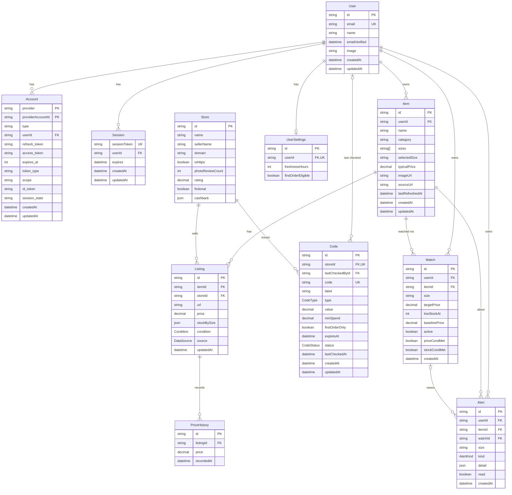

# Database schema

Built from `prisma/schema.prisma`. PostgreSQL on Neon. Every user-owned table filters by `userId` from the session.

`VerificationToken` (Auth.js) has no relations and is left out of the diagram. `Session` is unused: sessions are JWT, so the table stays empty.

## Ownership

| Model | Owner | Note |
|---|---|---|
| User, Account | Auth.js | Written by the Auth.js adapter. |
| Session | Auth.js | Unused. Sessions are JWT, so no rows are written. |
| Item | the signed-in user | Deleting the user deletes their items. |
| Listing | the item's owner | Reached through Item. Deleted with the item. One row per item, store and condition. |
| PriceHistory | the item's owner | Reached through Listing. Deleted with the listing. |
| Watch | the signed-in user | One per user, item and size. Deleted with the item or user. |
| Alert | the signed-in user | Deleted with the item or user. Each alert stores the watch `size`, so deleting a watch keeps its alerts with their size and sets `watchId` to null. Removing a size in PATCH items deletes that size's watches and their alerts. |
| UserSettings | the signed-in user | One row per user, created at sign-up by the `createUser` event. Reads fall back to defaults if the row is missing, and PATCH upserts it. |
| Store | shared | Any signed-in user can read. Created by seed or `prisma/catalog.ts`, which also keeps the store details up to date on every deploy. |
| Code | shared | Any signed-in user can read and mark live or dead, which sets `lastCheckedAt` and `lastCheckedById`. Created by seed, `prisma/catalog.ts` (the demo codes on every deploy, production included), or ingestion only. `(storeId, code)` is unique, so a store has one row per code text. `lastCheckedAt` is null until someone checks the code; the catalog's demo codes start that way. |

## Alert dedupe

`Watch.priceCondMet` and `Watch.stockCondMet` remember whether each condition already holds. An alert is created only when a condition flips from false to true, so a price that stays below target does not alert again.
