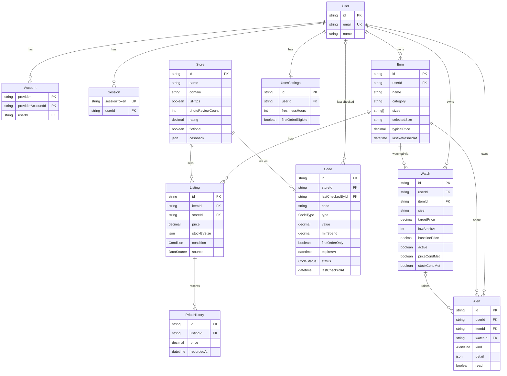

# Database schema

Built from `prisma/schema.prisma`. PostgreSQL on Neon. Every user-owned table filters by `userId` from the session.

`VerificationToken` (Auth.js) has no relations and is left out of the diagram.

## Ownership

| Model | Owner | Note |
|---|---|---|
| User, Account, Session | Auth.js | Written by the Auth.js adapter. |
| Item | the signed-in user | Deleting the user deletes their items. |
| Listing | the item's owner | Reached through Item. Deleted with the item. One row per item, store and condition. |
| PriceHistory | the item's owner | Reached through Listing. Deleted with the listing. |
| Watch | the signed-in user | One per user, item and size. Deleted with the item or user. |
| Alert | the signed-in user | Deleted with the item or user. Deleting its watch keeps the alert and sets `watchId` to null. |
| UserSettings | the signed-in user | One row per user, created on first save. |
| Store | shared | Any signed-in user can read. Created by seed only. |
| Code | shared | Any signed-in user can read and mark live or dead, which sets `lastCheckedAt` and `lastCheckedById`. Created by seed or ingestion only. |

## Alert dedupe

`Watch.priceCondMet` and `Watch.stockCondMet` remember whether each condition already holds. An alert is created only when a condition flips from false to true, so a price that stays below target does not alert again.
